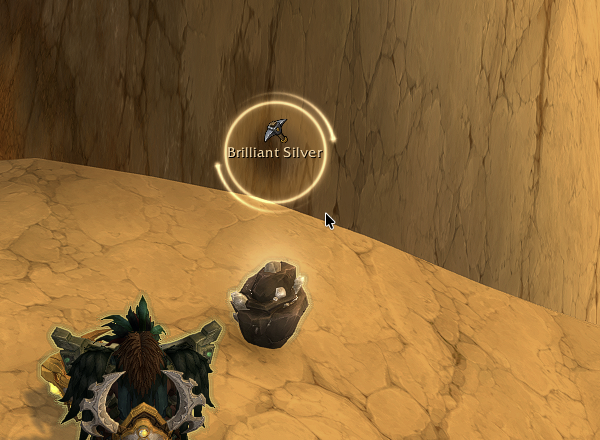
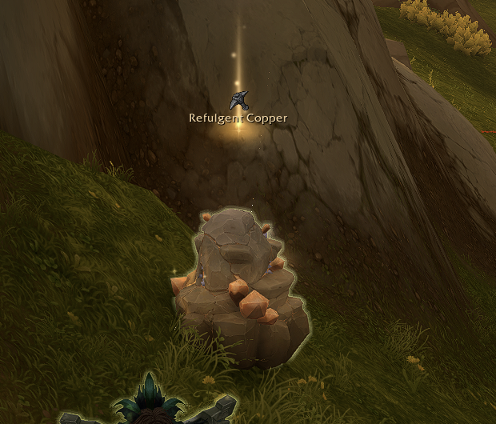
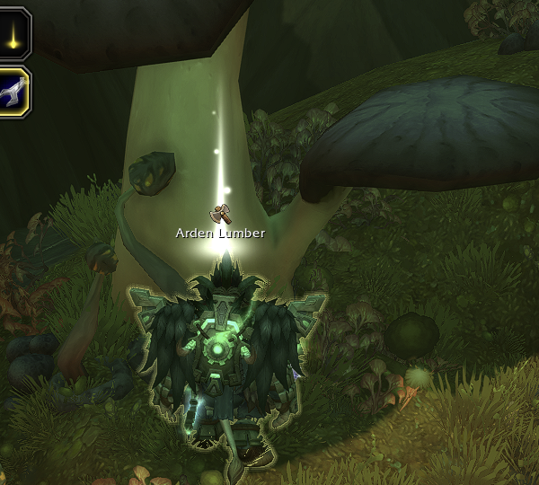
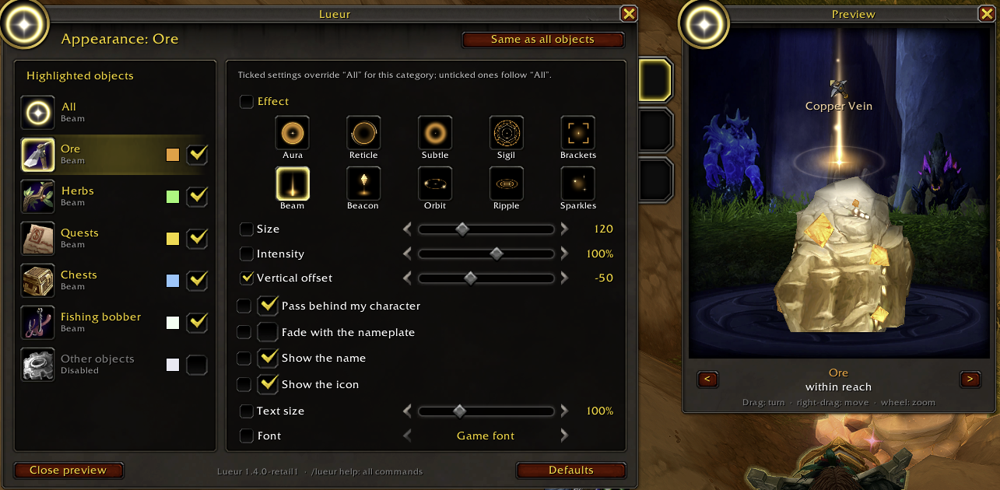
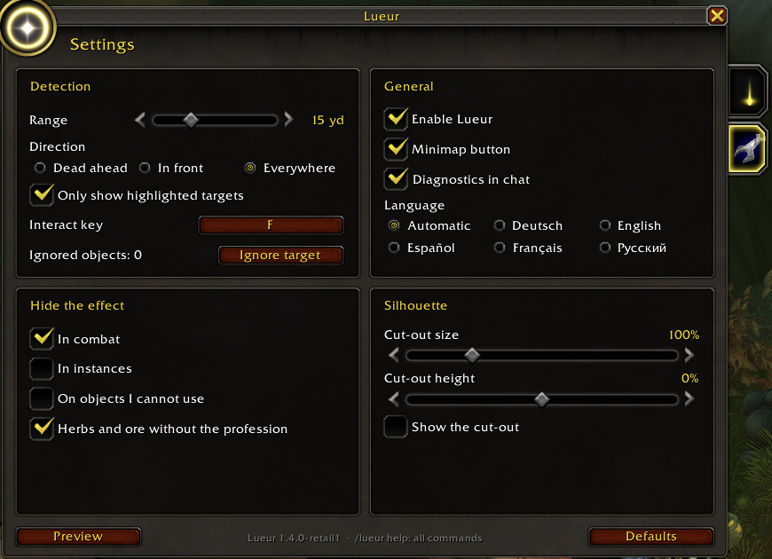

# Lueur: retail (Midnight) port

An unofficial port of **[Lueur](https://www.curseforge.com/wow/addons/lueur) by Armytille** to World of Warcraft Retail (Midnight, 12.1.x). Lueur makes the object you're about to interact with glow: ore veins, herbs, lumber trees, quest objects, chests and your fishing bobber.

All credit for the addon goes to Armytille. This port only adds what retail needs, plus a few features. The original is MIT licensed, and so is this port. See [LICENSE](Lueur/LICENSE).

  
  
  

*Reticle on ore · Beam on ore · the new Lumber category on an Arden Lumber tree.*

  
  

*Ore appearance with the new "Override All" checkboxes and the preview · the settings page.*

## Install

1. Download [Lueur-1.4.0-retail3.zip](Lueur-1.4.0-retail3.zip?raw=1) and unzip it, or copy the `Lueur` folder from this repo. Either way you get a `Lueur` folder; put it in `World of Warcraft/_retail_/Interface/AddOns/`.
2. Start WoW, or type `/reload` if it's already running.
3. Type `/lueur` to open the settings, or `/lueur help` for the commands.

This replaces the original Lueur, since it uses the same folder name and saved settings. Don't install both.

## What's different from 1.4.0

- Loads on retail (12.0.7 to 12.1.7) as well as Classic Era and Forever.
- **Lumber** category for housing lumber trees, with its own colour, checkbox and settings.
- **"All" is the base.** Changing a setting on "All" no longer wipes a category's own values. On each category page, an **Override All** checkbox beside every setting shows whether that category uses its own value or follows "All".
- Recognises Herbalism and Mining on retail for "hide on herbs and ore without the profession".
- Preview window: models stand on the dressing-room stone circle, ore sinks into the floor, and the label sits where retail puts it.
- Retail tab icons (Beam for objects, wrench for settings). The minimap page is hidden on retail, where the game doesn't let addons read the minimap dots.
- Detection range up to 40 yards on retail (experimental).

The full list, file by file, is in [CHANGELOG.md](CHANGELOG.md), including what didn't work and what's planned.

## For Armytille

This is offered back to you. Feel free to take any or all of it into the official Lueur. Every change is guarded so Classic Era and Forever should behave as in 1.4.0. The French comments are kept as they were, with an English translation added under each one (`-- EN:`). The port's own comments are tagged `(port retail)`, so they're easy to find. If you'd rather this didn't exist as a separate download, say so and it'll stay here only as a reference.

## Known issues

- The vertical offset can't land on the node at every distance, because retail moves a node's nameplate a lot depending on distance and camera angle. Tune it per category.
- The nameplate edge-clamping change has no effect on 12.1.5, because it uses CVars Midnight removed. A fix is planned, see the changelog.
- The Lumber preview has no 3D model.

## Reporting a bug

Open an issue with:
- what you were looking at and what happened
- the output of `/lueur status`, and the `Lueur:` chat lines with diagnostics on
- any Lua error text (turn errors on with `/console scriptErrors 1`)

## License

MIT. Original © 2026 Armytille, port changes © 2026 Lurx. See [LICENSE](Lueur/LICENSE).
