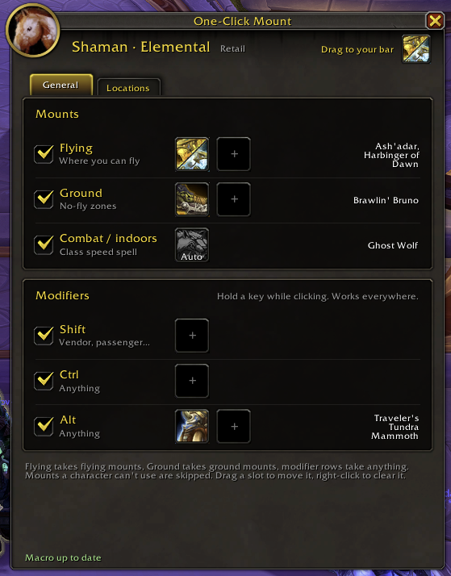
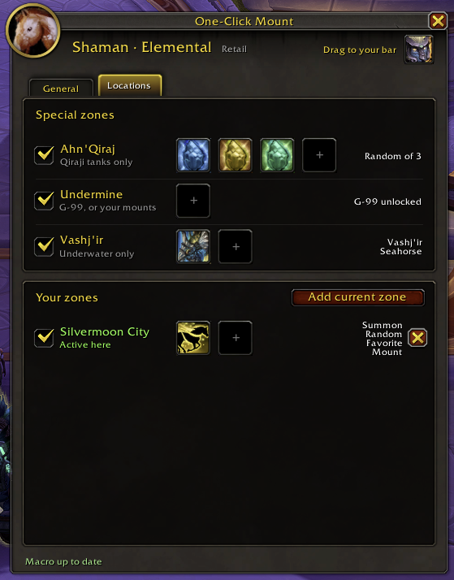
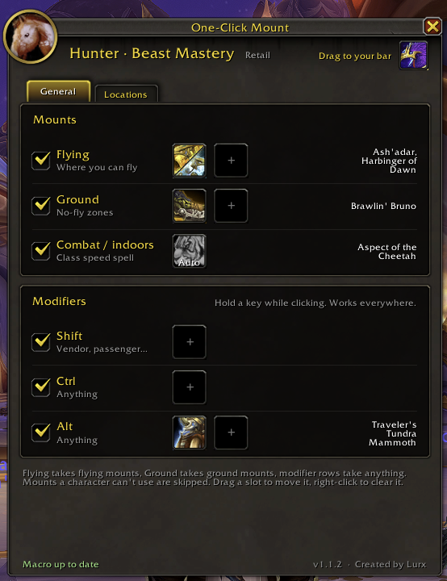

# One-Click Mount

One action bar button that picks the right mount or movement spell for where you are. World of Warcraft Retail (Midnight).

Created by Lurx.

  
  
  

*General tab · Locations tab · the same rules on a Hunter, where the combat spell switches to Aspect of the Cheetah by itself.*

## Install

1. Download the latest zip from [Releases](../../releases), or copy the `OneClickMount` folder from this repo.
2. Put the `OneClickMount` folder in `World of Warcraft/_retail_/Interface/AddOns/`.
3. Start WoW, or type `/reload` if it's already running.
4. Type `/ocm`, drag your mounts into the rows, then drag the icon at the top right onto your action bar. You need one free character macro slot.

## What the button does, in order

1. **In combat or indoors:** your class speed spell (Ghost Wolf, Aspect of the Cheetah, Travel Form, Divine Steed...), picked automatically for your class and spec.
2. **Holding Shift, Ctrl or Alt:** the mount in that row, such as a vendor or passenger mount.
3. **Special zones:** Qiraji tanks in Ahn'Qiraj, the G-99 Breakneck in Undermine, underwater mounts while swimming in Vashj'ir.
4. **Your own zones:** Locations tab, "Add current zone".
5. **Otherwise:** your Flying mount where you can fly, your Ground mount elsewhere.

## Features

- Drag mounts from the Mount Journal; several in one row are picked at random.
- "Summon Random Favorite Mount" works in the Flying and Ground rows.
- Flying only takes flying mounts, Ground only takes ground mounts, and modifier rows take anything.
- Mounts a character can't use (wrong faction, not collected) are skipped automatically.
- Drag slots to move them, hold Ctrl to copy, right-click to clear.
- Every rule has an on/off checkbox.
- The settings window closes during combat and reopens afterwards.

## FAQ

**Q: Why can't I auto-cast an extra speed buff, like Crusader Aura or a second movement spell, together with the mount?**
A: One click can only cast one spell that triggers the global cooldown. A second one would block or delay your mount or speed spell, so the button sticks to one.

**Q: Will moving into or out of one of my zones dismount me?**
A: No. Zone rules only change which mount the button picks, so the new mount is used the next time you mount. Special zones work the same way, with one catch: zone-locked mounts like the G-99 or the Qiraji tanks only work in their zone, so the game itself may dismount you when you leave it.

## Reporting a bug

Open an issue with:
- what you clicked, where you were, and what happened
- the output of `/ocm debug`
- any Lua error text (turn errors on with `/console scriptErrors 1`)

## License

MIT, see [LICENSE](../LICENSE).
